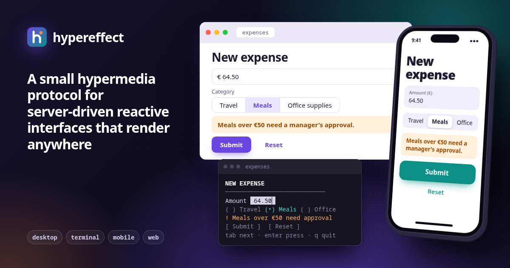

# hypereffect



A simple protocol for describing server-guided, reactive interfaces that can be rendered anywhere.

**[hypereffect.dev](https://hypereffect.dev)**: overview, component reference, spec and live demos.

## How it works

1. The **renderer** (the client) opens a session by sending `hello`. It knows nothing about the
   application yet.
2. The **server** answers with the state, as *signals*, and a few *elements*. The renderer draws
   them with its own native widgets, in its own style.
3. The user interacts. Each element declares up front the few interactions it supports, and a
   handler can do only two things: **patch the state locally**, which recomputes every attribute
   that depends on it, or **fire an action** to the server along with the current signals.
4. The server decides what happens next: it sends new elements, replaces or removes existing ones,
   or sends signal updates that are merged into the client's state.

Everything is newline-delimited, tagged JSON:

```
server → renderer
signal {"moisture":24}
element {"id":"plant","type":"column"}
element {"id":"soil","type":"notice","parent":"plant","variant":{"cel":"s.moisture < 30 ? 'warning' : 'success'"},"text":{"cel":"'Soil moisture ' + string(s.moisture) + '%'"}}
element {"id":"water","type":"button","parent":"plant","variant":"primary","label":"Water now","onPress":{"action":"water"}}

renderer → server
action {"name":"water","signals":{"moisture":24}}

server → renderer
signal {"moisture":61}
```

The notice turns from a warning into a success without being re-sent, because its text and variant
are expressions over the state.

## The pieces

- **Elements** form a tree built from a fixed set of eighteen components. They carry semantic
  variants (`h2`, `warning`, `primary`), never colours or margins, so each renderer is free to look
  native.
- **Signals** are the shared state: a JSON object patched with JSON Merge Patch (RFC 7386). Names
  starting with `_` are local and never leave the client. Inputs bind to signals in both directions.
- **Expressions** are [CEL](https://cel.dev) snippets in any attribute. They make an interface
  react instantly (show a field, enable a button, rewrite a label) with no round trip.
- **Actions** are the only way the client talks back, and the server stays the source of truth.

## Why it matters

- **One server, every screen.** The same messages can be drawn as a web page, a terminal UI or a
  mobile app, each with its own native widgets, accessibility and conventions. The server never
  ships HTML, CSS or a framework.
- **Native look and feel.** Because the protocol describes meaning rather than appearance, every
  renderer uses its platform's own widgets, fonts, spacing, accessibility and conventions. Apps
  feel like they belong, with no theming work.
- **Small enough to implement.** A fixed vocabulary and a handful of message types mean a renderer
  or a server is a weekend project, in any language.
- **Instant without being a client app.** Local patches and expressions keep the interface
  responsive and offline-tolerant for the small stuff, while all real decisions stay on the server.
- **Safe by construction.** No scripts are downloaded and no styling escapes the renderer. CEL is
  sandboxed and side-effect free, and handlers can only patch state or send a named action.
- **Built for simple applications.** Forms, dashboards, admin tools and small utilities don't need
  a client-side framework, a build pipeline or an API plus a separate UI to keep in sync.

## In this repository

- `site/`: the website at [hypereffect.dev](https://hypereffect.dev)
- `rust/`: types and helpers for servers and renderers
- `js/`: a dependency-free JavaScript renderer core
- `fixtures/`: renderer test scripts shared by both libraries

## Who is using it

- The [hyperb](https://github.com/hypereffect/hyperb) standalone browser for hypereffect apps
  - [Cathode](https://github.com/andunieee/cathode) desktop video player remote control
  - [Grassline](https://github.com/andunieee/grassline) agent control system admin panel
- [flipflop](https://github.com/andunieee/flipflop) offline collaborative apps
- [Ribolita](https://github.com/andunieee/ribolita) embedded programs interface
- [Cassis Order Protocol](https://github.com/cassiscash/cassis_order_protocol)
